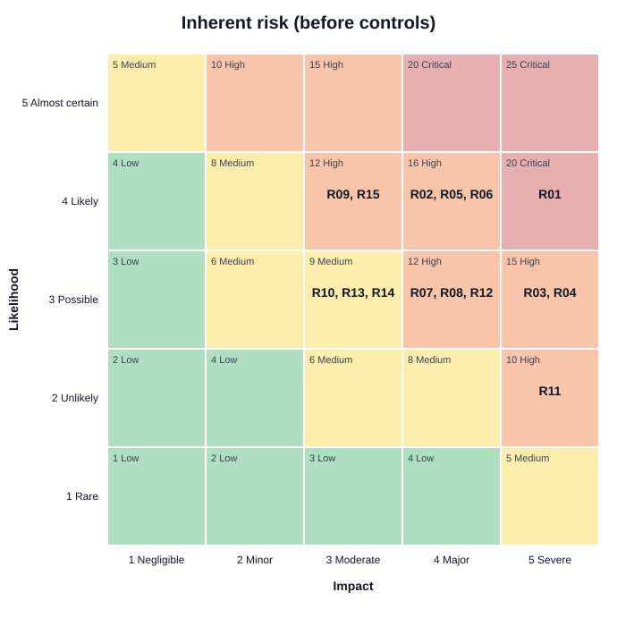

# Cyber Essentials Risk Assessment

[](https://github.com/Ezashi9/cyber-essentials-assessment/actions/workflows/ci.yml)

A security risk assessment and Cyber Essentials gap analysis for a small UK accountancy firm, written for the owner rather than for other security people. It comes with a small Python tool that checks the risk register and draws the heat maps, so the numbers can be reproduced.

> **The business is fictional.** Quillmere Accountancy Ltd, its staff and its systems were invented for this exercise. It is not based on any real firm.

## Why I built this

My other projects ([Log Hunter](https://github.com/Ezashi9/log-hunter), [IOC Enricher](https://github.com/Ezashi9/ioc-enricher), [Home SOC Dashboard](https://github.com/Ezashi9/home-soc-dashboard)) are about detecting attacks. But a lot of security work happens before anything is attacked: working out what matters, what could go wrong, and what to fix first with a limited budget. That's governance, risk and compliance (GRC).

Most UK businesses are small, with no security team. For them, the useful question isn't "what's the latest threat?" but "what should I do this month, and what will it cost?" This project answers that for one realistic small business, measured against [Cyber Essentials](https://www.ncsc.gov.uk/cyberessentials/overview), the UK government-backed scheme for basic cyber security.

## What's in it

| Document | What it is |
|---|---|
| [Executive summary](assessment/00-executive-summary.md) | One page for the managing partner. Plain English, top 5 risks, what to do first and why it's worth paying for |
| [1. Scope and context](assessment/01-scope-and-context.md) | The business, its data, what an attack would cost, and what's in scope |
| [2. Asset inventory](assessment/02-asset-inventory.md) | Devices, accounts, cloud services and data |
| [3. Risk method](assessment/03-risk-method.md) | How each risk is scored, and the method's limits |
| [Risk register](output/risk_register.md) | 15 risks with inherent score, control and residual score. Generated from [`risk_register.csv`](risk_register.csv) |
| [4. Cyber Essentials gap analysis](assessment/04-cyber-essentials-gap-analysis.md) | Each of the five control themes: current state, gap, fix, effort and cost |
| [5. Action plan](assessment/05-action-plan.md) | Quick wins in 2 weeks, next 3 months, longer term, with rough costs and owners |

## Method

1. **Scope.** Set the boundary using the scope rules in [Cyber Essentials: Requirements for IT Infrastructure v3.3](https://www.ncsc.gov.uk/files/cyber-essentials-requirements-for-it-infrastructure-v3-3.pdf) (NCSC, April 2026). That's the current version, effective from 27 April 2026. Under v3.3, every end-user device and every cloud service holding the firm's data must be in scope.
2. **Assets.** List what the firm has and what state it's in.
3. **Risks.** For each risk, score likelihood (1 to 5) and impact (1 to 5) on defined scales. Score = likelihood x impact.

   | Score | Rating |
   |---|---|
   | 20 to 25 | Critical |
   | 10 to 16 | High |
   | 5 to 9 | Medium |
   | 1 to 4 | Low |

4. **Controls.** Recommend a fix for each risk and score it again to get the residual risk.
5. **Gap analysis.** Compare the firm against each Cyber Essentials v3.3 requirement, quoting the official wording.
6. **Map.** Tag every risk with its Cyber Essentials theme and the NCSC [10 Steps to Cyber Security](https://www.ncsc.gov.uk/collection/10-steps) area, so risks that sit outside Cyber Essentials (like backups and payment fraud) aren't forgotten.

## Headline findings

**Quillmere would fail Cyber Essentials today, on all five themes.** The biggest blocker is that no cloud service uses multi-factor authentication (MFA). v3.3 says "authentication to cloud services must always use MFA".

| Rating | Today | After the plan |
|---|---|---|
| Critical | 1 | 0 |
| High | 11 | 0 |
| Medium | 3 | 8 |
| Low | 0 | 7 |

Top 5 risks:

| ID | Risk | Score |
|---|---|---|
| R01 | Phishing leads to email account takeover (no MFA) | 20 Critical |
| R02 | Payment and bank detail fraud | 16 High |
| R05 | Reused and weak passwords | 16 High |
| R06 | Everyone is an administrator | 16 High |
| R03 | Ransomware through unpatched software (made worse by R04, backups that wouldn't survive it) | 15 High |



The most useful finding: **the most important fixes cost nothing.** MFA, blocking email forwarding, a phone call to check bank details and closing old accounts are all free. The firm already pays for Microsoft 365. The settings just aren't switched on. The first two weeks of the plan cost about £1,100 to £2,400, mostly a replacement for the unsupported Windows 10 PC.

The government's [Cyber Security Breaches Survey 2025/2026](https://www.gov.uk/government/statistics/cyber-security-breaches-survey-20252026/cyber-security-breaches-survey-20252026) puts this in context: 46% of small businesses reported a breach or attack in the last 12 months, phishing was by far the most common type, and only 12% of small businesses held Cyber Essentials.

## The risk register tool

`risk_register.py` reads [`risk_register.csv`](risk_register.csv) and:

- **validates** it: every score is a whole number from 1 to 5, required fields aren't empty, IDs are unique, Cyber Essentials themes, 10 Steps areas and timeframes come from fixed lists, and no control makes a risk *worse*. It reports every problem at once, with line numbers, and exits with an error code.
- **computes** inherent and residual scores and ratings.
- **writes** a Markdown risk register, an ASCII heat map and SVG heat maps (before and after controls) to `output/`.

Standard library only. Python 3.9 or newer.

```bash
python risk_register.py                       # reads risk_register.csv, writes to output/
python risk_register.py my_register.csv --out reports
```

On Windows, use `py` instead of `python`.

Example console output:

```
15 risks validated.
Inherent risk (before controls)

Likelihood
      +-------------+-------------+-------------+-------------+-------------+
  5   |     (M)     |     (H)     |     (H)     |     (C)     |     (C)     |
      +-------------+-------------+-------------+-------------+-------------+
  4   |     (L)     |     (M)     |   R09,R15   | R02,R05,R06 |     R01     |
      +-------------+-------------+-------------+-------------+-------------+
  3   |     (L)     |     (M)     | R10,R13,R14 | R07,R08,R12 |   R03,R04   |
      +-------------+-------------+-------------+-------------+-------------+
  2   |     (L)     |     (L)     |     (M)     |     (M)     |     R11     |
      +-------------+-------------+-------------+-------------+-------------+
  1   |     (L)     |     (L)     |     (L)     |     (L)     |     (M)     |
      +-------------+-------------+-------------+-------------+-------------+
             1             2             3             4             5
                                       Impact
```

Why a tool for a paper exercise? A risk register in a spreadsheet drifts: someone changes a likelihood and forgets the score, or types 6 on a 1 to 5 scale. Keeping the register as data and generating the report means the numbers in every document come from one place and are checked every time.

Run the tests:

```bash
python -m unittest discover -s tests -t .
```

The tests cover every rating band boundary, each validation rule, the heat map layout, SVG output, the command-line exit codes, and check that the real register still passes validation and covers all five Cyber Essentials themes.

## Project layout

```
assessment/        the written assessment (start with 00-executive-summary.md)
risk_register.csv  the risk register, the single source for all scores
risk_register.py   validator and report generator
output/            generated risk register, ASCII and SVG heat maps
tests/             unit tests
```

## Sources

- NCSC, [Cyber Essentials: Requirements for IT Infrastructure v3.3](https://www.ncsc.gov.uk/files/cyber-essentials-requirements-for-it-infrastructure-v3-3.pdf), April 2026, and the [Cyber Essentials resources page](https://www.ncsc.gov.uk/cyberessentials/resources), which confirms v3.3 is current. Checked 15 October 2026.
- NCSC, [10 Steps to Cyber Security](https://www.ncsc.gov.uk/collection/10-steps).
- DSIT and Home Office, [Cyber Security Breaches Survey 2025/2026](https://www.gov.uk/government/statistics/cyber-security-breaches-survey-20252026/cyber-security-breaches-survey-20252026), published 30 April 2026.
- ICO, [Personal data breaches: a guide](https://ico.org.uk/for-organisations/report-a-breach/personal-data-breach/personal-data-breaches-a-guide/).

Costs in the action plan are rough estimates from typical 2026 prices, not quotes.

## How this was made

The business is fictional and so are its systems and the scores, which are my judgement of a realistic small firm. The assessment was produced with AI assistance. I'm responsible for understanding it and can explain every score, control and recommendation in it. The Cyber Essentials requirements and survey figures were checked against the official sources linked above.
